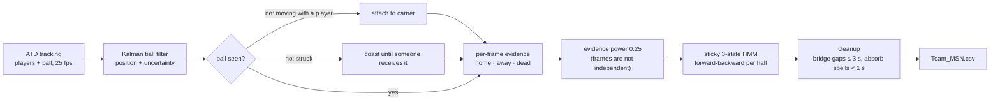

# Design decisions

Why the pipeline looks the way it does, what we tried that didn't work, and where it still
fails. TECHNICAL.md describes the method. This file explains the choices behind it. Every number
here comes from `docs/VALIDATION.md`, which `python3 tools/validation_report.py` regenerates from
open data (two Metrica matches and simulated ones), never from BAR-ATH.

## The pipeline at a glance

Team evidence is closeness to the ball times how well a player's velocity matches the ball's.
Dead-ball evidence comes from the ball leaving the pitch and from even the fastest players
slowing to a walk. Everything is hand-set with physical meaning. Nothing is trained.

Around the pipeline:

| piece | what it's for |
|---|---|
| `starter/synthetic_match.py` | invented matches with known truth, for choosing settings without touching the competition game |
| `tools/external_check.py` | the pipeline on Metrica's two open matches, with labels rebuilt from their event logs |
| `tools/dead_ball_study.py` | records each frame's raw evidence once, so settings can be compared in seconds |
| `tools/validation_report.py` | every measurement in `docs/VALIDATION.md`: intervals, ablations, sensitivity, calibration |
| `make_submission.py` | the submission, with every setting written out, the official validator, and the file's SHA-256 |

## Why a Kalman filter for the ball

The tracking has no ball position on 41% of graded frames, and the metric needs a call on every
one of them. We needed an estimate of where the ball is and how sure we are, because the
uncertainty decides how far the control test should reach. A constant-velocity Kalman filter
gives both, it is a few lines of linear algebra, and it doesn't need training data, which we
don't have.

The alternatives were weaker. The last seen position goes stale within a second of a dribble.
The nearest player (the published baseline) only works when the ball is visible. A learned
tracker needs labelled ball positions we don't have.

The plain filter wasn't enough on its own. A ball hidden at a dribbler's feet coasted away on
its last velocity, so we attach a hidden ball to the player it was last seen with when the two
were moving together, and let it coast only when it looked struck. When the ball is lost for a
long time and reappears somewhere else, the filter has to let go of its guess. Its uncertainty
has grown by then, so it accepts the new sighting at once. If it was pinned to the wrong carrier,
it rejects two sightings as outliers and believes the third. Tests cover both cases
(`tests/test_live_estimator.py`, `BallFilterTests`), and section 10 of the report measures it
on real gaps.

## Why velocity matching

Our first evidence rule was distance alone, and possession kept flipping to the defender
pressing the carrier. A presser is often as close to the ball as the carrier, but runs at the
ball while the carrier runs with it. So each player's control score is multiplied by how well
their velocity matches the ball's. The test only applies while the ball is seen, because a
hidden ball's velocity is our own guess.

We believed this was the most important factor in the model, and the ablation (below) only
half supports that. On held-out simulations, removing it costs 0.065 spellF1. On Metrica's two
matches it makes almost no difference (0.452 without it, 0.455 with). The simulator stages a
pressing defender next to every carrier, real matches less often. We kept it because it fixes
the failure it was built for and costs nothing on real football, but we no longer claim it is
the model's main ingredient. The sticky model and the cleanup matter more.

## Why the HMM is sticky, and why the evidence is discounted

The ranking metric scores whole possessions, so the problem is mostly about time: deciding when
possession really changed. Deciding frame by frame breaks possessions apart. The nearest-player
baseline gets most frames right and still predicts 2,057 possessions on Metrica where the
reference has 1,460. A hidden Markov model with a small chance of switching per frame treats a
possession as something that lasts.

Stickiness alone wasn't enough. Our first version predicted 36 possessions in the public window,
which has 17. Consecutive frames are nearly the same observation, and multiplying 25 of them
together as independent evidence lets one defender standing close for a second flip the state.
Raising each frame's evidence to the power 0.25 discounts that. We chose the power on simulated
matches, and it was confirmed on Metrica later.

The model is not fragile to its rates. Halving or doubling the switch, stop or restart
probability moves Metrica spellF1 by less than 0.01, which is well inside the noise band
(report section 9).

## Why Smart Tagging was left out

`starter/tag_prior.py` turns tags into gentle per-frame nudges. On simulated matches with noisy
fake tags, it gained about 0.02 spellF1 when the tags were mostly right and lost about the same
when they were often wrong. We then measured once how often the real tags name the team in
possession on the public window: 68%. That is in the range where the simulator says tags hurt,
so they stayed off. A breakdown suggested set pieces are far more reliable than phases, but
picking a component from the public window is the tuning RULES.md forbids, so we didn't act on
it.

## Why the cleanup uses 1 s and 3 s

The cleanup absorbs team spells shorter than 1 s and bridges dead or unknown gaps of up to 3 s
between spells of the same team. Both are football priors: a real possession lasts longer than
a second, and a ball unseen for under three seconds is almost always an occlusion. We didn't fit
them, and then we tested them against lighter and heavier versions (report section 2):

- **Without cleanup**, Metrica spellF1 drops from 0.455 to 0.405, and the paired interval
  excludes zero on all four Metrica runs.
- **Lighter cleanup** (0.5 s / 1.5 s, or either repair on its own) is never better, and is
  significantly worse on three of four runs. 0.5 s / 3 s ties with the submission.
- **Heavier cleanup** (2 s / 3 s) scores slightly higher on Metrica (0.460) and on the held-out
  simulations (0.726), but it is significant on only one of the four Metrica runs. It predicts
  only 0.74 possessions per reference possession and lowers transition F1. We kept 1 s / 3 s.

## Ablations

Each part taken away in turn, everything else as submitted (report section 11). spellF1, mean
over the four Metrica runs and the four held-out simulations:

| pipeline | Metrica | simulations |
|---|---|---|
| **submitted** | **0.455** | **0.710** |
| without stickiness (every frame decided alone) | 0.388 | 0.456 |
| without cleanup | 0.405 | 0.690 |
| without the evidence discount (power 1) | 0.428 | 0.655 |
| without the hidden-ball control cap | 0.428 | 0.710 |
| without the player-speed stoppage term | 0.432 | 0.600 |
| without velocity matching | 0.452 | 0.645 |
| nearest-player baseline | 0.369 | 0.406 |

The hidden-ball cap doesn't matter on simulations, which lose the ball at random, but it does
on Metrica, where the ball is missing in real play. That matches why we added it.

## What we tried that didn't work

| attempt | what happened | where it's recorded |
|---|---|---|
| evidence at full strength (power 1) | 36 possessions in the public window against 17; over-fragmented everywhere | TECHNICAL.md, commit `99e936f` |
| median player speed as a stoppage signal | useless: in open play most players walk or jog too | `live_estimator.py`, `SLOW_PLAYERS` |
| a fixed step of stoppage evidence when the fastest tenth slowed below 2 m/s | caught only 8-14% of dead-ball frames | commit `9ef5004`, `tools/dead_ball_study.py` |
| uncapped team evidence while the ball is hidden | the guessed ball, pinned to a nearby player, outvoted almost every stoppage | commit `9ef5004` |
| "ball unseen" as stoppage evidence | looked strong on Metrica only because Metrica loses the ball on 84% of dead frames; every candidate was rechecked with it off | TECHNICAL.md |
| Smart Tagging nudges | helped only with tags right ~80% of the time; real ones were 68% right | section above |
| the broadcast ATD | on a different timeline from the submission (164,488 vs 199,319 frames) | TECHNICAL.md |
| answering live with zero lag after the dead-ball change | more fragmented on simulations (spellF1 0.485 to 0.411); the submission is offline, so we kept the change | TECHNICAL.md |
| answering with 1 s of hindsight | more fragmented than zero lag on Metrica (2.4 against 1.7 possessions per reference one): a second of hindsight lets a short burst of evidence flip the call | report section 7 |

## Known failure cases

These are measured, not guessed (report sections 3-8):

- **Transitions are found but not placed precisely.** The scoreboard's transition F1 (1 s
  tolerance) is 0.18 on the public window and 0.28-0.35 on Metrica. At 5 s it is 0.64-0.67, so
  most changes are found, just not to the second. Turnovers and stoppages have a median timing
  error near zero. Restarts are late, a median 1.3 s on Metrica, because the model waits for
  players to speed up after the restart. Moving each restart 0.5 s earlier in the cleanup helps
  on both Metrica and the held-out simulations, but by less than the noise band, so we haven't
  changed the submission for it.
- **Short possessions are mostly lost.** Of Metrica's reference possessions under 2 s, 6% are
  matched (30% on simulations). The sticky model and the 1 s cleanup both trade them away for
  fewer invented ones. Part of this is the reference itself: event-built labels contain many
  one-touch spells.
- **Stoppages where players keep moving are missed, and slow spells of open play are called
  dead.** Dead-ball recall is 0.83-0.87 and precision 0.72-0.78 on Metrica, with about 46-51
  false stoppages per 90 minutes, averaging 7-9 s. Quick restarts under 5 s are found about
  half the time.
- **Confidence is not a probability.** Frames the offline model calls at 99% or more are right
  85% of the time on Metrica and 97% on simulations (calibration error 0.18 and 0.06). Part of
  the Metrica gap is the approximate reference.
- **The ball filter is too sure of itself on long gaps.** It locks back on almost at once when
  the ball reappears (within 2 frames 98-99% of the time). But after 2 s unseen, only 35-47% of
  its errors fall inside twice its stated uncertainty, because a ball pinned to the wrong carrier
  keeps a small uncertainty. The hidden-ball cap limits the damage to the possession call.
- **Identity switches in real tracking.** BAR-ATH has 46 track slots for 22 players. The
  pipeline only uses each slot's team, so it is unaffected, but anything per player (the
  Console's speeds) has to treat a slot that jumps across the pitch as a tracking error.
- **No restart model.** After a stoppage, the first team to control the ball gets it, not the
  team taking the throw-in.

## Keeping it honest and reproducible

- The submission is deterministic. `make_submission.py` writes out every setting it uses, runs
  the official validator and prints the file's SHA-256 (`42cc1f8a…aeb9e`). Since that hash was
  recorded, only comments and docstrings have changed on the submission path.
- `python3 -m unittest discover -s tests` runs 63 tests that need no match data, including
  checks that the simulator's default output never moves and that the ball filter recovers from
  long gaps. `cd web && npm test` covers the web code.
- Every setting was chosen on simulated matches or on Metrica's open data. The public five
  minutes of BAR-ATH were used only to check that the pipeline runs, and each change was scored
  there once, afterwards.
- We built this with help from an AI coding assistant (Claude Code). It never read the BAR-ATH
  files. We ran everything that touches the match data ourselves, and it's all in the commit
  history.
